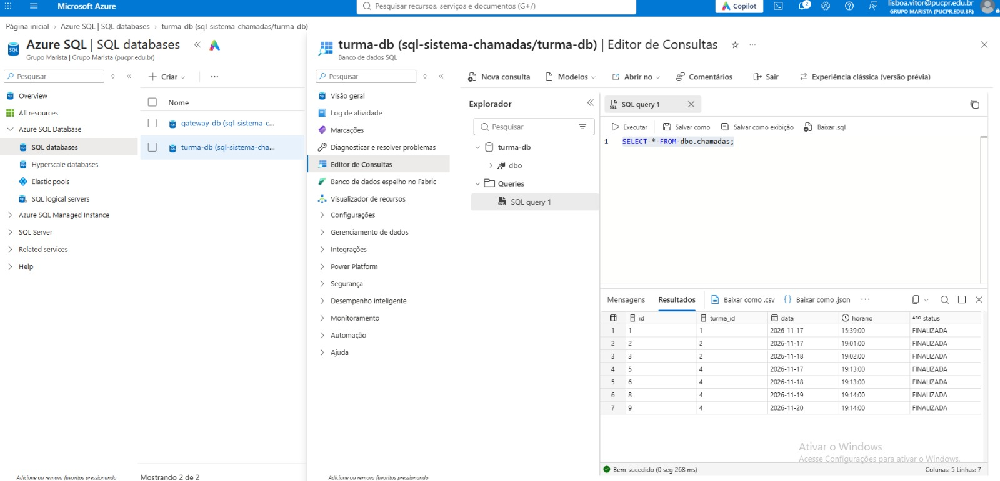
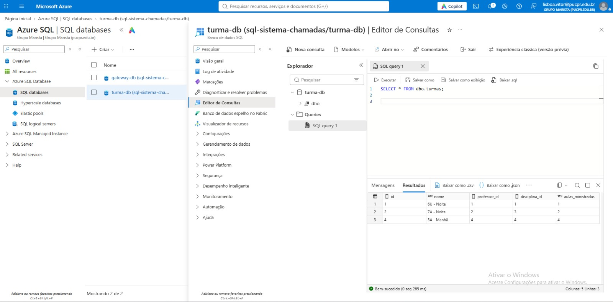
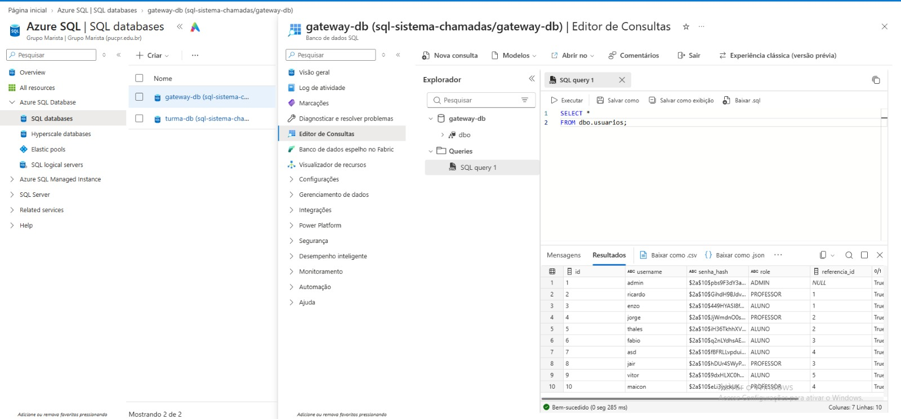
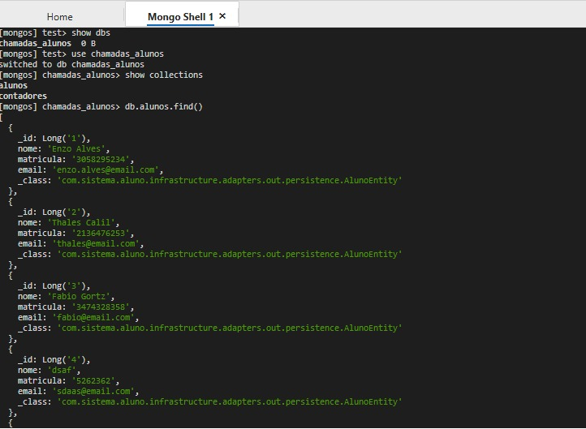

# Sistema de Chamadas - API Gateway / BFF

> **Vídeo de demonstração do sistema:** https://youtu.be/aqNFj_S9aUA
>
> **Como executar localmente** (frontend, backend e API Gateway): [docs/EXECUCAO_LOCAL.md](docs/EXECUCAO_LOCAL.md)
> · **Arquitetura (arc42):** [docs/arc42.md](docs/arc42.md)

Rotas: `/api/alunos/**` → aluno-service; `/api/turmas/**`, `/api/professores/**`, `/api/disciplinas/**`,
`/api/chamadas/**` e `/api/presencas/**` → turma-service (o chamada-service foi incorporado a ele).

## API Gateway - configuração no Azure (App Service app-api-gateway-chamadas)

Variáveis de ambiente obrigatórias (Configuração > Configurações do aplicativo):

| Variável | Exemplo / observação |
|---|---|
| `GATEWAY_DB_URL` | `jdbc:sqlserver://<servidor>.database.windows.net:1433;database=<banco>;encrypt=true;trustServerCertificate=false;loginTimeout=30;` |
| `GATEWAY_DB_USER` | usuário do Azure SQL |
| `GATEWAY_DB_PASSWORD` | senha do Azure SQL |
| `JWT_SECRET` | texto aleatório com 32+ caracteres (o mesmo valor será usado pelos microsserviços) |
| `ADMIN_INITIAL_PASSWORD` | senha do primeiro admin (8+ caracteres). Usada só se ainda não existir ADMIN |
| `ALUNO_SERVICE_URL`, `TURMA_SERVICE_URL` | URLs dos microsserviços (chamadas e presenças são atendidas pelo turma-service) |
| `FRONTEND_URL` | URL do App Service do frontend (ex.: `https://app-frontend-chamadas-<código>.mexicocentral-01.azurewebsites.net`, com `https` e sem barra no fim), liberada no CORS |

Opcionais: `ADMIN_INITIAL_USERNAME` (padrão `admin`), `JWT_EXPIRATION_MS` (padrão 8h).

A tabela `usuarios` é criada automaticamente pelo Flyway na primeira subida.

Deploy: o workflow publica com o perfil de publicação do App Service (secret `AZURE_PUBLISH_PROFILE_GATEWAY`).

### Endpoints de autenticação

- `POST /api/auth/login` - `{ "username", "password" }` -> token, role, referenciaId, expiresIn
- `GET /api/auth/me` - dados do usuário logado
- `GET|POST /api/auth/usuarios`, `PUT /api/auth/usuarios/{id}` (editar login, perfil e vínculo),
  `DELETE /api/auth/usuarios/{id}`, `PUT /api/auth/usuarios/{id}/senha|ativar|desativar` - somente ADMIN.
  Para PROFESSOR e ALUNO, `referenciaId` = id do professor (turma-service) ou do aluno (aluno-service).
  Regras: 404 se o usuário não existir; 409 para login ou vínculo repetidos, para excluir o próprio usuário e para
  excluir ou rebaixar o único ADMIN ativo.

### Headers repassados aos microsserviços

`X-User-Id`, `X-User-Role` (ADMIN/PROFESSOR/ALUNO), `X-Ref-Id` (id do aluno/professor), `X-Username`.
Headers com esses nomes enviados pelo cliente são descartados.

## Execução local

Passo a passo completo (bancos em Docker, variáveis, ordem e portas): [docs/EXECUCAO_LOCAL.md](docs/EXECUCAO_LOCAL.md).

## Evidências no banco de dados

As capturas abaixo foram tiradas **diretamente nos bancos de dados** do Azure, consultando as tabelas e coleções pelo Editor de Consultas do Azure SQL e pelo Mongo Shell do Cosmos DB. Elas comprovam que os cadastros, turmas e chamadas feitos durante o [vídeo de demonstração](https://youtu.be/aqNFj_S9aUA) foram **persistidos de fato** no banco relacional (**Azure SQL**) e no banco NoSQL (**Azure Cosmos DB for MongoDB**).

**1. Azure SQL — banco `turma-db`, tabela `dbo.chamadas`** (`SELECT * FROM dbo.chamadas`): chamadas criadas e finalizadas, com turma, data, horário (`TIME`) e status `FINALIZADA`.

**2. Azure SQL — banco `turma-db`, tabela `dbo.turmas`** (`SELECT * FROM dbo.turmas`): turmas com professor, disciplina e o contador `aulas_ministradas`, somado a cada chamada finalizada.

**3. Azure SQL — banco `gateway-db`, tabela `dbo.usuarios`** (`SELECT * FROM dbo.usuarios`): logins de administrador, professores e alunos, com senha guardada só como hash BCrypt e `referencia_id` apontando para o professor (turma-service) ou o aluno (aluno-service).

**4. Azure Cosmos DB for MongoDB — banco `chamadas_alunos`, coleção `alunos`** (`db.alunos.find()`): alunos cadastrados pela aba Usuários, com id numérico (`Long`) gerado pela coleção `contadores`.

## Observações do desenvolvimento (frontend)

Problemas encontrados: 
1. Ao instalar o vitejs, dava problema de versão por ser a versão mais recente não carregando os módulos ao testar, a solução encontrada foi dar um downgrade de versão nos remotes para 7.3.0 do vite e para 5.1.4 do react. 
2. Ao tentar utilizar o TypeScript como linguagem, havia conflito com o module federation, assim ao usar o federation, o código não entendia o que era o método.

Comandos para atualizar e rodar após alterar:

npm run build:remotes
npm run start
